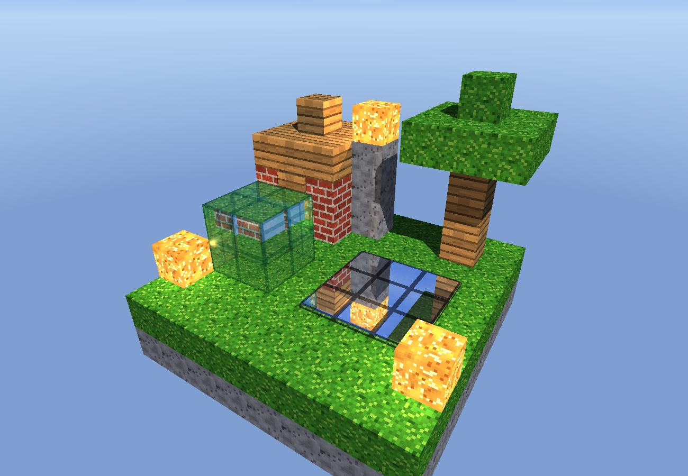

# Diorama con Raytracing (Proyecto 2)

Raytracer en Zig con [raylib](https://www.raylib.com/) solo para abrir la ventana y mostrar el framebuffer. Todo lo demás (intersecciones, materiales, texturas, cielo, hilos) está escrito en Zig puro. Las texturas y el skybox se generan por código, no hay archivos de imagen.

El diorama es una isla de bloques con una casa de ladrillo, un árbol, un bloque grande de vidrio, una baldosa de espejo y tres lámparas de piedra luminosa.

## Video

> TODO: pegar aquí el link o el video del diorama.

## Cómo se ve



## Requisitos

- [Zig](https://ziglang.org/) 0.16.0

## Correrlo

```sh
zig build run -Doptimize=ReleaseFast
```

`ReleaseFast` es importante: sin optimizar el render es mucho más lento.

### Controles

| Tecla / mouse | Acción |
|---|---|
| `A` / `D` o arrastrar con el mouse | Rotar el diorama (la cámara orbita) |
| `W` / `S` | Inclinar la cámara arriba / abajo |
| Rueda del mouse (o trackpad), `Q` / `E`, `↓` / `↑` | Alejar / acercar |
| `R` | Giro automático |
| `M` | Calidad mientras se mueve la cámara: 1/4, 1/2 o resolución completa |
| `H` | Ocultar el texto en pantalla |
| `P` | Guardar `captura.png` con lo que se ve |

Mientras la cámara se mueve se renderiza a menor resolución para que sea fluido; cuando se queda quieta se renderiza un cuadro completo (1300x900).

### Render a archivo

Sin abrir ventana, útil para sacar cuadros en alta resolución para el video:

```sh
./zig-out/bin/proyecto_02 --render salida.png [ancho alto [giro inclinacion distancia]]
./zig-out/bin/proyecto_02 --render salida.png 2600 1800 1.0 0.5 11
```

## Qué implementa

| Requisito | Dónde |
|---|---|
| **Rotación** del diorama | Cámara orbital (`placeCamera` en `src/main.zig`), con teclado, mouse y giro automático |
| **Zoom** | Rueda / `Q` `E` cambian la distancia de la cámara (entre 4 y 40) |
| **Materiales** (7, cada uno con su textura y sus parámetros de albedo, especular, transparencia y reflectividad) | `src/scene.zig`: pasto, piedra, madera, ladrillo, espejo, vidrio y piedra luminosa. Texturas en `src/texture.zig` |
| **Refracción** | Ley de Snell en `refract` (`src/tracer.zig`), con reflexión interna total y entrada y salida del medio. El bloque de vidrio tiene índice 1.5 |
| **Reflexión** | Rayo reflejado recursivo en `castRay`. Para el vidrio se mezcla con refracción según Fresnel (aproximación de Schlick) |
| **Sombras** | Rayo hacia cada luz (`lightVisibility`). Los objetos transparentes dejan pasar parte de la luz |
| **Skybox** | Imagen equirectangular generada por código (degradado, nubes y sol) que se muestrea según la dirección del rayo (`Texture.sampleSky`). También se ve reflejada y refractada |
| **Concurrencia** | `render` en `src/tracer.zig` reparte las filas entre un `std.Thread` por núcleo; cada hilo toma la siguiente fila con un contador atómico |
| **Materiales que brillan** | `Emision` en `Material`: la piedra luminosa suma su textura como color propio, y además cada lámpara tiene una luz puntual cálida que ilumina lo que tiene cerca |

También: cubos con textura por cara repetida cada unidad (`src/cube.zig`), iluminación de Phong (difuso y especular) con atenuación por distancia y luz ambiental.

## Estructura

```
src/
  main.zig        - ventana, controles, cámara orbital y render a archivo
  tracer.zig      - castRay (Phong, sombras, reflexión, refracción, emisión) y render con hilos
  scene.zig       - materiales y objetos del diorama, luces
  texture.zig     - texturas procedurales de los bloques y el skybox
  raytracer.zig   - tipos base: Light, Material, Intersect
  cube.zig        - caja alineada a los ejes e intersección
  sphere.zig      - esfera e intersección (soportada, no se usa en el diorama)
  formas.zig      - unión de formas soportadas (Forma)
  camera.zig      - cámara (lookAt, Right/Up/Forward)
  framebuffer.zig - buffer de píxeles que se sube a una textura de raylib
  cute_colors.zig - utilidades de color
```
